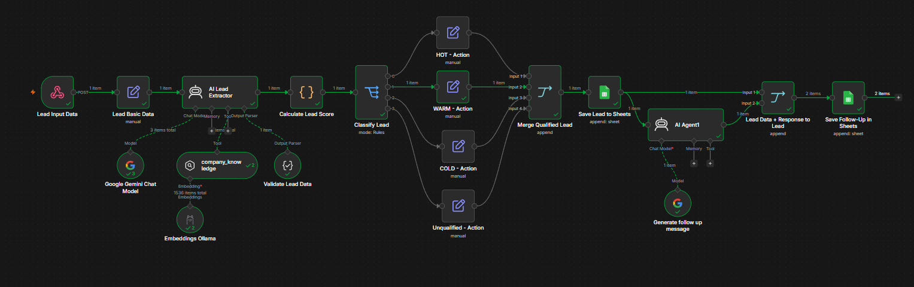

# AI-Powered Lead Qualification & Follow-Up Automation

An AI-powered lead qualification and follow-up automation project built with **n8n, Retrieval-Augmented Generation (RAG), Google Gemini, Ollama, and Google Sheets**.

The system retrieves company-specific knowledge, extracts structured lead information, evaluates lead quality using configurable business rules, assigns a qualification category, and generates personalized follow-up messages.

The project contains two complementary workflows:

1. **Knowledge Base Ingestion Workflow** — reads company knowledge files, generates embeddings, and stores them in n8n's Simple Vector Store.
2. **Lead Qualification Workflow** — retrieves the stored knowledge to evaluate incoming leads, calculates scores, classifies leads, and generates follow-up message drafts.

## Features

- **RAG-based knowledge retrieval:** Retrieves relevant company information from a vector store.
- **Knowledge base ingestion:** Loads company knowledge files, extracts and chunks text, generates embeddings, and stores vectors for retrieval.
- **AI-powered lead extraction:** Extracts structured lead details from unstructured input.
- **Automated lead scoring:** Evaluates leads based on budget, requirement clarity, timeline, business fit, service fit, and decision-maker involvement.
- **Four-level classification:** Categorizes leads as HOT, WARM, COLD, or UNQUALIFIED.
- **Automated workflow routing:** Routes leads according to their qualification category.
- **Google Sheets integration:** Stores lead details, scores, classifications, and follow-up messages.
- **Personalized follow-ups:** Generates professional follow-up message drafts based on available lead information.
- **Missing-information handling:** Keeps unavailable information unknown instead of inventing values.
- **Local embeddings:** Uses Ollama and the `nomic-embed-text` model for embedding generation.
- **Modular architecture:** Separates knowledge preparation from lead processing.

## Technology Stack

- **n8n** — Workflow automation and orchestration
- **Google Gemini** — AI-powered lead extraction and follow-up message generation
- **Ollama** — Local embedding generation
- **nomic-embed-text** — Embedding model
- **n8n Simple Vector Store** — Vector storage and similarity search
- **Google Sheets** — Lead records and follow-up message storage
- **JavaScript** — Lead scoring and classification logic
- **Docker Desktop** — Runs n8n locally in a container

## Workflow Architecture

This project contains two workflows that work together.

### Workflow 1: Knowledge Base Ingestion

**File:** `workflow/knowledge-base-ingestion-workflow.json`

This workflow prepares company knowledge so the lead qualification workflow can retrieve relevant information.

Processing steps:

1. Reads the company knowledge-base files.
2. Extracts text from source documents or file data.
3. Splits the content into manageable text chunks.
4. Generates embeddings using Ollama and `nomic-embed-text`.
5. Stores the embedded documents in n8n's Simple Vector Store.

Run this workflow before using the lead qualification workflow for the first time and whenever you update the knowledge base.

**Important:** Repeated ingestion may create duplicate chunks depending on the node configuration. Check whether the workflow clears or replaces existing data before re-ingesting documents.

### Workflow 2: Lead Qualification and Follow-Up

**File:** `workflow/lead-qualification-workflow.json`

This workflow uses the prepared knowledge base to evaluate incoming leads.

Processing steps:

1. Receives lead information.
2. Retrieves relevant company knowledge through RAG.
3. Extracts structured lead attributes using an AI agent.
4. Validates and structures the extracted data.
5. Calculates the lead score using JavaScript.
6. Classifies the lead as HOT, WARM, COLD, or UNQUALIFIED.
7. Routes the lead through the corresponding branch.
8. Merges the classification branches.
9. Stores lead information, score, and classification in Google Sheets.
10. Generates a personalized follow-up message and saves it to the sheet.

The generated follow-up message is a draft. The workflow does not automatically send it to the lead unless a separate communication integration is configured.

### Execution Order

1. Configure the required services and credentials.
2. Start Ollama and verify that n8n can connect to it.
3. Configure the Simple Vector Store and retrieval nodes.
4. Run the Knowledge Base Ingestion Workflow.
5. Verify that the knowledge has been stored successfully.
6. Execute the Lead Qualification Workflow with a sample lead.
7. Review the qualification result and follow-up message in Google Sheets.

The lead qualification workflow depends on the Simple Vector Store containing the required company knowledge.

**Storage note:** Simple Vector Store is intended primarily for development and experimentation. Depending on the node configuration and n8n version, stored data may not survive a restart or container recreation. Verify its persistence behavior in your environment and re-run ingestion if the stored vectors have been lost.

## Lead Scoring

The scoring model considers the following criteria:

| Criterion | Maximum Points |
|---|---:|
| Budget | 30 |
| Requirement clarity | 25 |
| Timeline | 20 |
| Business fit | 10 |
| Service fit | 10 |
| Decision-maker involvement | 5 |
| **Total** | **100** |

The classification logic also applies qualification rules. For example, a lead must meet the required budget category and score threshold to qualify as HOT. Low-budget leads and leads with a confirmed business or service mismatch may be rejected by the current rules.

Classification thresholds and qualification rules can be adjusted in the JavaScript scoring node.

The scoring model is a configurable business-rule system, not a guarantee that a lead will convert into a customer.

## Knowledge Base

The example knowledge base contains the following files:

- `companyinformation.txt` — Company information
- `faq.txt` — Frequently asked questions
- `ideal-customer-profile.txt` — Target customer characteristics
- `pricing.txt` — Budget and pricing guidance
- `qualification-rules.txt` — Lead qualification rules
- `services.txt` — Available services

These documents provide company-specific context for retrieval and qualification decisions. Replace the demonstration content with appropriate business information when adapting the project.

## Repository Structure

```text
ai-lead-qualification-automation/
├── README.md
├── workflow/
│   ├── knowledge-base-ingestion-workflow.json
│   └── lead-qualification-workflow.json
├── knowledge-base/
│   ├── companyinformation.txt
│   ├── faq.txt
│   ├── ideal-customer-profile.txt
│   ├── pricing.txt
│   ├── qualification-rules.txt
│   └── services.txt
├── sample-data/
│   └── test-leads.csv
└── Project-Screenshots/
    └── workflow-overview.png
```

This structure is illustrative. The actual file and folder names in your repository must match the paths referenced in this README.

## Testing

The workflows have been tested with scenarios including:

- Strong and weak leads
- All four classification categories
- Missing budget information
- Missing timeline information
- Vague requirements
- Unsupported services
- End-to-end execution through Google Sheets
- Follow-up message generation and storage

Sample lead data is provided in `sample-data/test-leads.csv`.

Actual outcomes depend on the workflow configuration, input data, knowledge base, AI output, and scoring rules. If you change the scoring logic, update the expected classifications in the sample dataset accordingly.

## Setup Guide

### Prerequisites

Before running this project, you need:

- A Windows computer for the Docker and Ollama setup described below
- Docker Desktop
- n8n running in Docker
- Ollama installed on Windows
- The `nomic-embed-text` embedding model
- A Google Gemini API key, if required by the imported workflow
- A Google account with Google Sheets access
- The project knowledge-base files

**Supabase and pgvector are not required** for the current implementation because it uses n8n Simple Vector Store.

Other operating systems and hosted deployments may require different network and file-path settings.

### 1. Clone or Download the Repository

Clone the repository:

```bash
git clone <your-github-repository-url>
cd ai-lead-qualification-automation
```

Replace `<your-github-repository-url>` with your actual GitHub repository URL.

Alternatively, download the repository as a ZIP file and extract it.

### 2. Run n8n Using Docker Desktop

Install and start [Docker Desktop](https://www.docker.com/products/docker-desktop/).

Run n8n in Docker, or use your existing n8n container. If you already have a working n8n installation, you do not need to create another container.

The following configuration examples assume n8n runs in Docker Desktop on Windows and Ollama runs directly on the Windows host.

### 3. Configure the Knowledge-Base Volume Mount

The ingestion workflow needs access to the knowledge-base files from inside the n8n container.

For example, if the files are stored on Windows at:

```text
C:\N8N\AI-Lead-Qualification\knowledge-base
```

They can be mounted inside the container at:

```text
/files/knowledge-base
```

Example volume mapping:

```text
C:\N8N\AI-Lead-Qualification\knowledge-base:/files/knowledge-base
```

Use your actual Windows directory. Ensure Docker Desktop can access it and that the container path matches the paths used by your workflow nodes.

**Important:** Windows host paths generally cannot be used directly by file-reading nodes inside the Linux-based n8n container. Use the corresponding container path, such as `/files/knowledge-base`.

### 4. Configure n8n File-Access Permissions

Mounting the directory alone may not be sufficient. n8n also applies file-access restrictions.

An incorrectly configured environment can cause errors such as:

`Access to the file is not allowed`

Configure the environment variable to allow access to the mounted knowledge-base directory, provided this matches the configuration supported by your n8n version:

```text
N8N_RESTRICT_FILE_ACCESS_TO=/files/knowledge-base
```

In Docker Desktop:

1. Open your n8n container configuration.
2. Add the environment variable under the container's environment settings.
3. Set its value to `/files/knowledge-base`.
4. Recreate the container with the updated configuration so the variable takes effect.
5. Verify that the workflow's file nodes use paths within `/files/knowledge-base`.

If using Docker Compose, configure the variable in the n8n service's `environment` section and the directory in its `volumes` section.

Example configuration fragment:

```yaml
services:
  n8n:
    environment:
      - N8N_RESTRICT_FILE_ACCESS_TO=/files/knowledge-base
    volumes:
      - C:/N8N/AI-Lead-Qualification/knowledge-base:/files/knowledge-base
```

This is an illustrative fragment, not a complete Docker Compose file. Add it to your existing n8n service configuration rather than replacing your entire configuration.

**Verify the exact environment variable against your working installation and your n8n version.** If you resolved your original file-access error using a different variable, document that exact setting instead. Refer to the official [n8n environment variables documentation](https://docs.n8n.io/hosting/configuration/environment-variables/) for version-specific behavior.

Avoid granting n8n access to the entire host filesystem when only the knowledge-base directory is required.

### 5. Install and Configure Ollama on Windows

This project uses **Ollama running on the Windows host machine while n8n runs inside Docker Desktop**.

Install Ollama from:

https://ollama.com/download

Open PowerShell and download the embedding model:

```powershell
ollama pull nomic-embed-text
```

Check the installed models:

```powershell
ollama list
```

Ensure Ollama is running. The n8n container connects to Ollama through:

```text
http://host.docker.internal:11434
```

**Why use `host.docker.internal`?**

This hostname allows a container to connect to a service running on the host machine. Here, n8n runs inside Docker, while Ollama runs on Windows.

In n8n:

1. Open the Ollama credential used by the embedding node.
2. Set its base URL to `http://host.docker.internal:11434`.
3. If the credential reference does not resolve after importing the workflow, create a new Ollama credential.
4. Select the `nomic-embed-text` model in the embedding node.
5. Execute the node to test the connection.

Ollama commonly runs locally without API-key authentication by default. Do not expose the Ollama service directly to untrusted networks. Configure networking and firewall rules appropriately.

**Important:** `host.docker.internal` is intended for containers connecting to services on the host machine. Linux or hosted deployments may require a different hostname or network configuration.

### 6. Configure Google Gemini

Create or configure your own Google Gemini API credential in n8n if the imported workflow uses Gemini nodes.

If the credential reference in the exported JSON does not resolve in your n8n instance, create a new credential and select it in the relevant nodes.

Never upload your actual API key to GitHub.

### 7. Configure Google Sheets

Create or select a Google spreadsheet for storing lead records and follow-up drafts.

Configure your own Google Sheets credentials in n8n and select the appropriate spreadsheet and worksheet in the workflow nodes.

Make sure the spreadsheet columns match the data fields expected by the workflow.

### 8. Import the Workflows

Import both JSON files into n8n:

1. `workflow/knowledge-base-ingestion-workflow.json`
2. `workflow/lead-qualification-workflow.json`

After importing, inspect the nodes and configure any missing credentials, model names, spreadsheet IDs, file paths, and Simple Vector Store settings.

Exported workflow JSON files contain workflow configuration and credential references, but they do not automatically transfer the original owner's credentials or guarantee that every external service is configured for your environment.

### 9. Run the Knowledge Base Ingestion Workflow

Before processing leads:

1. Verify that Ollama is accessible from n8n.
2. Confirm that all required knowledge-base files can be read.
3. Execute the ingestion workflow.
4. Check for successful embedding generation and vector storage.
5. Verify that the lead qualification workflow uses the corresponding Simple Vector Store configuration.

Do not assume ingestion is complete until you have checked the execution results.

If your Simple Vector Store data has been lost after restarting n8n, run ingestion again before testing lead qualification.

### 10. Run the Lead Qualification Workflow

Provide a sample lead or use the supplied CSV as a reference for test cases.

Execute the workflow and inspect:

- Extracted lead attributes
- Budget and timeline categories
- Qualification score
- Final classification
- Google Sheets output
- Generated follow-up message

Confirm that the results match the scoring rules configured in your workflow.

## Troubleshooting

### Ollama Connection Fails

- Verify that Ollama is running on Windows.
- Check that `nomic-embed-text` is installed.
- Confirm that the Ollama credential uses `http://host.docker.internal:11434`.
- Check Docker networking and Windows firewall settings.

### Knowledge-Base Files Cannot Be Found

- Confirm that the Docker volume mount is configured.
- Verify the file paths inside the container.
- Check that the knowledge-base files exist in the mounted directory.

### "Access to the File Is Not Allowed"

- Confirm that the knowledge-base directory is mounted into the n8n container.
- Verify the file-access environment variable supported by your n8n version.
- Recreate the container after changing environment variables.
- Make sure the file node uses a container path within the allowed directory.

### Vector Retrieval Returns No Relevant Results

- Confirm that ingestion completed successfully.
- Check that the ingestion and retrieval workflows use the appropriate Simple Vector Store configuration.
- Verify the embedding model and that both workflows use compatible embeddings.
- Check the retrieval query and vector-store settings.
- Re-run ingestion if the stored vectors have been lost.

### Imported Workflow Nodes Show Missing Credentials

- Create your own credentials in n8n.
- Select those credentials in the relevant nodes.
- Verify external service permissions and connection settings.

Exact node settings, credential types, environment variables, and file paths may vary by n8n version and deployment environment.

## Workflow Overview



## Security

- Never commit API keys, OAuth client secrets, access tokens, passwords, or other credentials.
- Use your own credentials when importing the workflows.
- Review workflow exports for sensitive values before publishing them.
- Do not publish private lead information or confidential business documents.
- Use synthetic lead data for public demonstrations.
- Restrict access to your n8n instance and Google Sheets as appropriate.
- Avoid exposing local services such as Ollama to untrusted networks.
- Treat publicly accessible workflow exports as configuration files that may reveal internal node names, paths, and implementation details.

## Limitations

- Classification depends on the quality of extracted information and configured scoring rules.
- RAG quality depends on the content, chunking, embeddings, and retrieval configuration of the knowledge base.
- Simple Vector Store is intended primarily for development and experimentation. Verify its persistence behavior before relying on stored vectors across restarts or container recreation.
- Follow-up messages are generated drafts; generation does not itself send messages to leads.
- Actual outreach requires valid contact information and a separately configured communication integration.
- Human review is recommended before acting on important qualification decisions.
- The project requires correct credentials and configuration for all connected services.
- The local Ollama and Docker configuration described here may need adaptation for other environments.

## Future Improvements

- Email or WhatsApp integration with appropriate consent
- Lead deduplication and record updates
- A dashboard for lead analytics
- More comprehensive monitoring and error notifications
- Human review and feedback to improve qualification accuracy
- Automated knowledge-base refresh and duplicate-safe ingestion
- A persistent vector database for deployments requiring reliable storage across restarts

## Author

Built as a practical AI automation project to explore RAG, vector search, structured AI outputs, business-rule scoring, and workflow orchestration.
